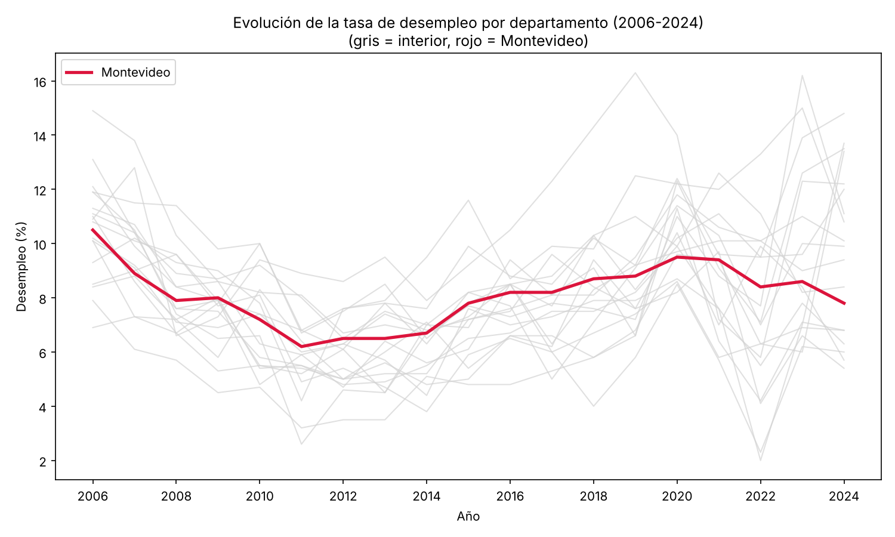

# Repositorio individual — Introducción a la Ciencia de Datos

**Paulina Gericke**
Universidad de Montevideo · Facultad de Ciencias Empresariales y Economía · 2026

Trabajos realizados durante el curso, organizados por clase. Material del
curso: [DavytJ/Introduccion-a-la-ciencia-de-datos](https://github.com/DavytJ/Introduccion-a-la-ciencia-de-datos).

---

## Estructura

```
repositorio-individual-paulina/
├── clase02_caja_negra/              Medición y datos sintéticos
├── clase03-04_carga_de_datos/       Carga y perfilado de un dataset abierto (R y Python)
├── clase05_seudocodigo/             Del seudocódigo al código
├── clase06_encuesta/                Diseño de encuesta y carga de respuestas
├── clase07_carga_de_datos_y_rutas/  Rutas relativas, codificación y transformación
├── clase08-09_imagen/               Gráfico del proyecto macro
├── clase10_transito_y_aire/         ¿El tránsito ensucia el aire?
├── claseIA_ticket/                  Leer un ticket con IA (API de Gemini)
├── datos/                           Archivos de datos que usan los scripts
├── figuras/                         Gráficos generados por el proyecto macro
├── requirements.txt
└── README.md
```

Todos los scripts usan **rutas relativas** a la raíz del repositorio (buscan la
carpeta `.git`, igual que `here::here()` en R), así que funcionan en cualquier
computadora sin cambiar nada. Los resultados se guardan en `salidas/`, que no se
sube a GitHub porque se regenera al correr el código.

---

## Trabajos

### Clase 2 — La caja negra · [`clase02_caja_negra/`](clase02_caja_negra)

Dinámica de aula: objetos dentro de una caja cerrada que se tocan sin verlos.
La caja representa el **proceso generador de datos (DGP)**: solo vemos lo que
medimos, no lo que hay adentro.

- `caja_negra.py`: pasa las mediciones a un DataFrame declarando el tipo de
  cada variable (nominal, ordinal, discreta, continua, metadato), describe la
  muestra y genera **datos sintéticos** por bootstrap (N = 100) y por una
  Normal ajustada (N = 500). El gráfico compara real vs sintético.
- Conclusión: el bootstrap no inventa valores; la Normal sí, y como la caja
  tiene objetos muy distintos genera pesos "fantasma" (incluso negativos que
  hay que recortar).

### Clases 3 y 4 — Carga de datos · [`clase03-04_carga_de_datos/`](clase03-04_carga_de_datos)

Ejercicio en clase con un dataset abierto: **población por sexo, tramo de edad
y departamento** (INE).

- `ejercicio_dataset_abierto.R`: carga el CSV, elimina las filas de
  encabezado, nombra las 15 columnas, las convierte a numéricas y hace el
  perfilado (estructura, valores únicos, NA, cadenas vacías, duplicados).
- `carga_de_datos.py`: el mismo ejercicio en Python, con control de
  codificación (UTF-8 → latin-1) y un chequeo de coherencia
  (hombres + mujeres = total).
- `multiple_opcion_paulina_gericke.pdf`: ejercicio de opción múltiple sobre
  objetos, tipos y errores en R y Python.

### Clase 5 — Seudocódigo · [`clase05_seudocodigo/`](clase05_seudocodigo)

Diseñar la lógica antes de escribir la sintaxis.

- `seudocodigo.md`: cuatro ejercicios en seudocódigo (ingesta con control de
  codificación, filtrar temperaturas, perfilar un DataFrame, clasificar
  temperaturas).
- `seudocodigo.py` y `seudocodigo.R`: la traducción de cada ejercicio a
  Python y a R, para comparar el bucle con la versión vectorizada.

### Clase 6 — Encuesta · [`clase06_encuesta/`](clase06_encuesta)

Diseño de encuestas: **diseñar la tabla antes que el formulario**.

- `cuestionario_cafeteria.md`: libro de códigos y cuestionario para la
  encuesta a clientes de la cafetería (7 preguntas → 13 columnas, con filtro
  después de la frecuencia) y la bitácora con las seis preguntas mal
  formuladas: problema, reescritura y tipo de variable.
- `cafeteria_ejercicios.py`: carga y perfila las respuestas, declara el orden
  de las variables ordinales y controla que el filtro se haya respetado
  (faltante por diseño vs no respuesta).

### Clase 7 — Carga de datos y rutas · [`clase07_carga_de_datos_y_rutas/`](clase07_carga_de_datos_y_rutas)

Calidad del aire en Montevideo (ozono, PM2.5) y conteo vehicular, datos
abiertos de la Intendencia de Montevideo.

- `carga_y_rutas.py`: rutas absolutas vs relativas, directorio de trabajo,
  `pathlib`; carga con verificación del archivo y de la codificación; arreglo
  de nombres de estaciones mal codificados (`ñ` → `ñ`); perfilado; paso de
  datos minutales a promedios por hora y por día; gráfico del ozono diario.
- Los CSV de la Intendencia son pesados y no están en el repo: descargarlos y
  guardarlos en `datos/` con los nombres indicados al inicio del script.

### Clases 8 y 9 — Imagen · [`clase08-09_imagen/`](clase08-09_imagen)

Gráfico para el **proyecto macro** (nivel de actividad económica por
departamento en Uruguay).

- `imagen_proyecto_macro.py`: evolución de la tasa de desempleo por
  departamento (2006–2024), con el interior en gris como contexto y
  Montevideo resaltado en rojo. Lee la tabla del Observatorio Social (MIDES)
  en `datos/desempleo_departamentos.csv` (formato ancho, un año por columna),
  la pasa a formato largo, saca la fila del total país y guarda el gráfico.
- `imagen_proyecto_macro.pdf` y [`figuras/01_desempleo_evolucion.png`](figuras/01_desempleo_evolucion.png):
  el gráfico resultante.



### Clase 10 — Script de datos de aire y tránsito · [`clase10_transito_y_aire/`](clase10_transito_y_aire)

¿El tránsito ensucia el aire? Tres estaciones de Montevideo, junio de 2024,
datos por hora (`datos/transito_aire_junio2024.csv`).

- `transito_aire.py`, en cinco pasos, cada uno con su gráfico:
  1. una semana de las tres series;
  2. el día típico, entre semana y fin de semana;
  3. correlación y recta: en Tres Cruces, NO2 = 18,3 + 0,79 × miles de
     vehículos/h (r = 0,59; R² = 0,35; 291 horas). El PM2.5 no se relaciona
     con el tránsito (r ≈ 0);
  4. desvíos respecto del ciclo diario: sin el ciclo, la r del NO2 baja a
     0,20 → buena parte de la correlación cruda era el ritmo diario compartido;
  5. correlación con rezagos: el NO2 responde al tránsito de 1–2 horas antes.
- Nota: el archivo marca la hora como UTC pero los valores ya están en hora
  local (si se convierte, el tránsito "arranca" a las 3 de la mañana).

### Clase IA — Ticket · [`claseIA_ticket/`](claseIA_ticket)

Usar un modelo de IA como herramienta de **extracción de datos**: de la foto
de un ticket a una tabla.

- `leer_ticket.py`: convierte la foto a base64, arma la solicitud JSON, la
  envía a la API de Gemini (POST), lee la respuesta, guarda la tabla como CSV
  y controla la calidad comparando la suma de los ítems con el total impreso.
- `ticket.jpg`: foto de ejemplo.
- La clave va en `claseIA_ticket/clave_gemini.txt`, que está en `.gitignore`
  y **no se sube a GitHub**.

---

## Cómo correr el código

```bash
git clone https://github.com/pauugericke-netizen/repositorio-individual-paulina.git
cd repositorio-individual-paulina
pip install -r requirements.txt
python clase10_transito_y_aire/transito_aire.py
```

En Visual Studio Code los scripts están divididos en celdas `# %%` para
correrlos por partes. Los scripts de R necesitan
`install.packages(c("here", "readr", "dplyr"))`.

| Script | Datos que necesita en `datos/` | ¿Incluidos? |
|---|---|---|
| `clase02_caja_negra/caja_negra.py` | ninguno (datos en el código) | — |
| `clase03-04_carga_de_datos/*` | `2pobporsextodpto .csv` | no |
| `clase05_seudocodigo/*` | `transito_aire_junio2024.csv` | sí |
| `clase06_encuesta/cafeteria_ejercicios.py` | `Ejercicio intro - Hoja 2.csv` | no |
| `clase07_carga_de_datos_y_rutas/carga_y_rutas.py` | CSV de ozono, PM2.5 y autoscope | no |
| `clase08-09_imagen/imagen_proyecto_macro.py` | `desempleo_departamentos.csv` | sí |
| `clase10_transito_y_aire/transito_aire.py` | `transito_aire_junio2024.csv` | sí |
| `claseIA_ticket/leer_ticket.py` | `ticket.jpg` + clave de Gemini | foto sí, clave no |
